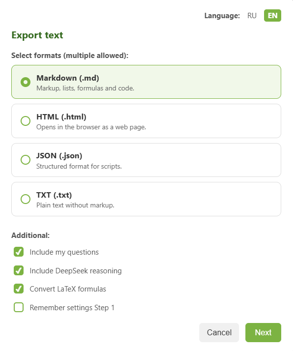
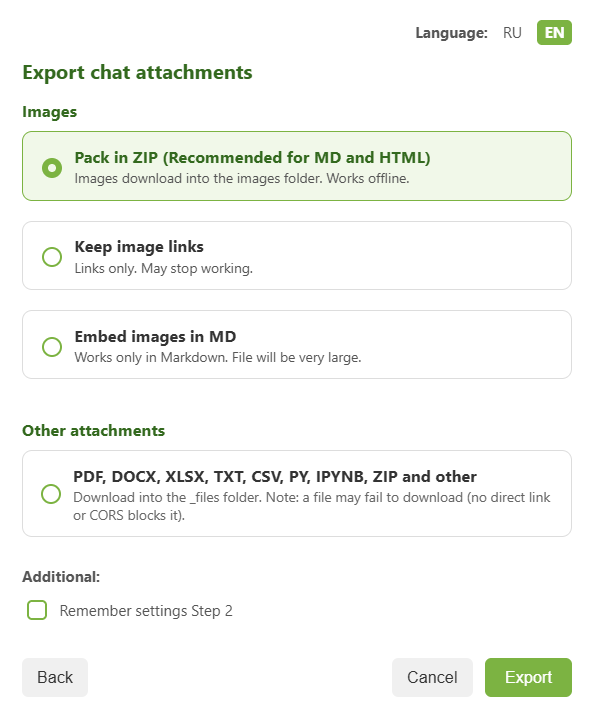

# Deepseek Chat Exporter Bookmarklet

Русская версия — [README.ru.md](README.ru.md).

A bookmarklet to export a chat from **chat.deepseek.com** into clean Markdown / HTML / JSON / TXT — with images, documents, and clickable web-search sources (when the chat has saved links in the browser). Key differences from alternatives:
- **No installation: it's just a browser bookmark acting as a chat extractor.**
- **Transparent code**
- **No data sent to third parties**
- **Written in JavaScript**

>Tested in Chrome (158.0.8127.37 (64-bit)) / Edge (v. 158.0.4370.33 (64-bit)) / Yandex Browser (26.10.3.771 (64-bit)) / Firefox / Opera (157.0.8103.79 (64-bit)). You must be logged into DeepSeek.

---

## Why a bookmarklet

The author works with DeepSeek and exports chats to Obsidian for reasoning analysis. Instead of third-party plugins, a lightweight and private tool was written, filling a niche that GitHub doesn't cover yet: at the time of writing, no bookmarklet-based DeepSeek exporter was found on GitHub.

Key differences from exporter plugins:

- Not a userscript (no Tampermonkey) and not an extension (no installation) — just a bookmark.
- Does not send errors/sessions/replay, usage events, or chat HTML during PDF/Word conversion to third parties.
- No remote config and no account — talks only to DeepSeek.
- Downloads files from the chat (when links are active); code is open for review.

---

## What the bookmarklet can do

A focused tool for working with DeepSeek. At ~37KB (vs "all-in-one" combos >10MB), the script can:

| Capability | Description |
| --- | --- |
| **Save in formats** | Markdown (.md), HTML (.html), JSON (.json), TXT (.txt) — several at once |
| **Save all questions and answers** | Exported separately, with `# you asked` / `# deepseek response` headers and timestamps |
| **Preserve formula formatting** | LaTeX formulas normalized to `$...$` / `$$...$$` (render in Obsidian, GitHub, etc.) |
| **Preserve code style** | Code blocks and inline code are kept as-is |
| **Save images** | 3 modes: download to ZIP (MD/HTML) / keep links / embed base64 (MD only) |
| **Save other files** | Downloads PDF, DOCX, XLSX, TXT, CSV, PY, IPYNB, ZIP and more — into a `_files` folder |
| **Save links (web-search sources)** | Extracts web-search sources and turns `[citation:N]` citations into clickable links in MD |
| **Save AI reasoning** | Optional (off by default) |
| **Remember settings** | Format and mode selection can be saved in localStorage |

---

## Screenshots

**Step 1 — formats** (the RU/EN language switcher is in the top-right corner):



**Step 2 — attachments**:



---

## Installation

1. Open [`bookmarklet_RU_EN_bilingual.txt`](bookmarklet_RU_EN_bilingual.txt) and copy **all** of its content to the clipboard.
2. Create a new bookmark in your browser.
3. Open the bookmark for editing.
4. Enter any name in the "Name" field.
5. Paste the copied code into the **URL** field.
6. Click "Save".
7. Done — the bookmark is ready.

> You can create the bookmark icon in any way that is known and convenient for you.

---

## Usage

1. Open the desired chat on `chat.deepseek.com` (logged in).
2. Click the bookmark.
3. In the **"Export text"** dialog — choose formats and options, click **"Next"**.
4. In the **"Export chat attachments"** dialog — choose the image/file export mode, click **"Export"**.
5. A ZIP archive `<chat_name>_<YYYYMMDD>_<HHMMSS>.zip` downloads (where `<YYYYMMDD>` is the date and `<HHMMSS>` is the time).

### Archive structure

```
<chat_name>.md          ← selected text export format (if selected)
<chat_name>.html        ← selected text export format (if selected)
<chat_name>.json        ← selected text export format (if selected)
<chat_name>.txt         ← selected text export format (if selected)
<chat_name>_images/     ← images (ZIP mode)
<chat_name>_files/      ← documents (if enabled)
```

---

## Why images/files sometimes fail to download

The script works through **DeepSeek's internal API** (`/api/v0/chat/history_messages`) — the same one the site uses to show you the chat.

Possible failure reasons:

1. **The API changed or is temporarily down.** This is an internal (non-public) API — it may change without notice. If it "dies", the script simply can't get the data and shows an error.
2. **CORS.** Images and files physically live on another domain (`files.deepseeksvc.com`). The browser allows downloading via `fetch` only if the server sends CORS headers. If not — the file won't download into the archive and stays a **link** (or just a name).
3. **No direct link.** In old chats an attached file may be visible in the UI but have no download link in the API data. Then only the file name is output.

In these cases the export doesn't fail — the image/file just stays a link instead of a file in the archive.

---

## Privacy

This script was built with privacy in mind:

- The **code** runs **entirely in your browser** and **only when you click the bookmark**.
- **Data** is sent **only to DeepSeek's own servers** — for the same chat you already see on screen.
- **No** background processes, analytics, telemetry, trackers, or requests to any third-party servers.
- The **only** external dependencies are two public JS libraries from CDN: `JSZip` (ZIP creation) and `marked` (HTML rendering). You can remove them from the code if you want and export unarchived.
- **All code** is one readable file — every line can be inspected. No obfuscation.

---

## Security comparison

A brief comparison of our bookmarklet with a typical popular chat-export extension (based on a surface-level forensic look at its code).

| Criterion | Our bookmarklet | Popular extension |
| --- | --- | --- |
| When it runs | Only when you click the bookmark | A background script runs constantly |
| Where it connects | Only to DeepSeek's servers | To the developer's server |
| Code size | ~37KB (single file) | >10 MB (group of files) |
| Third-party libraries | 2 public (JSZip, marked) from CDN | Everything bundled, no way to review |
| Code readability | One readable file, no obfuscation | Minified, source cannot be read |
| Your token | Used only in your browser | Stored/used by the extension with broad permissions |

> **Disclaimer:** we accuse no one — this is just a surface-level look at the code.

---

## Limitations

- You must be logged into DeepSeek in this browser (the token is taken from `localStorage`, never sent anywhere).
- Internet is required (API request, image/file download, loading `JSZip`/`marked`).
- The HTML file needs internet to display formulas (it loads `MathJax`).

---

## How the project was made

This script was written in **vibe-programming** mode (AI-assisted development): iteratively, on request, without a formal spec or full test suite.

History: previously browser plugins in "free" mode were used for MD export, but one of them stopped working in the RU domain — apparently for political reasons. This raised the question of third-party app security and led to writing our own code.

It is an **experimental personal tool**, not a production product. Use at your own risk: the author does not guarantee that DeepSeek's internal API will work tomorrow.

---

## License

[CC BY-NC 4.0](LICENSE)

---

## Integrity check (SHA-256)

SHA-256 of `bookmarklet_RU_EN_bilingual.txt`: `3FF7B6BBC9E63567A811165F111624A76B0472879054D3DF48A57A4B8A27340C`

Verify (Windows PowerShell): `Get-FileHash bookmarklet_RU_EN_bilingual.txt -Algorithm SHA256`. If the hash matches — the file is unchanged.


