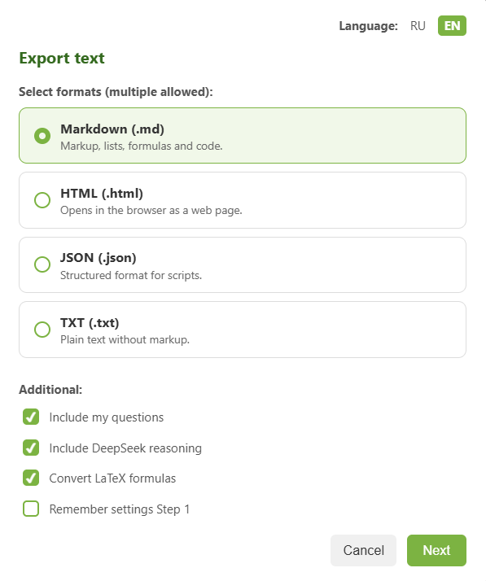
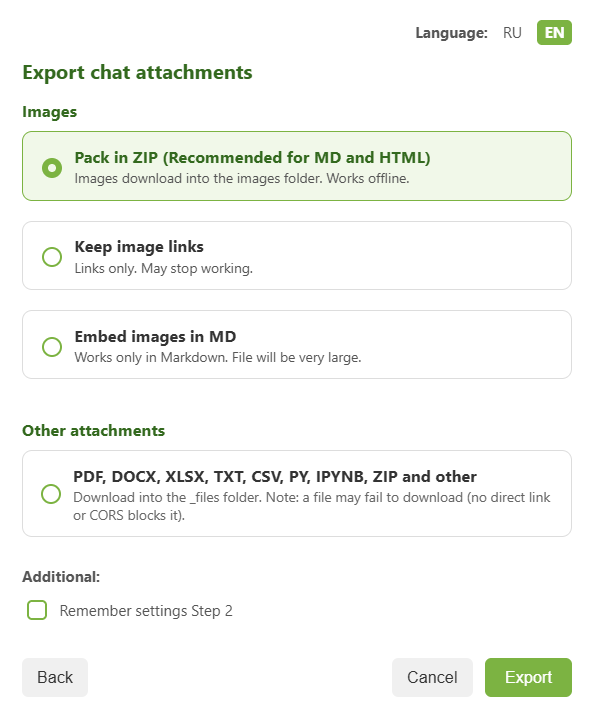

# Deepseek Chat Exporter Bookmarklet

Русская версия. Основной README — на английском: [README.md](README.md).

Предлагаемый букмарклет предназначен для экспорта чата из **chat.deepseek.com** в чистые Markdown / HTML / JSON / TXT — с картинками, документами и кликабельными источниками веб-поиска (при наличии сохранённых ссылок внутри чата в браузере). Основное отличие от аналогов:
- **Не требует установки: это просто закладка в браузере выполняющая функцию экстрактора чата.**
- **Прозрачность кода**
- **Отсутствие отправки данных третьим лицам**
- **Код написан на JavaScript**
 
>Работоспособность кода проверена в Chrome (158.0.8127.37 (64 бит)) / Edge (v. 158.0.4370.33 (64-bit)) / Яндекс Браузере (26.10.3.771 (64-bit))/ Firefox / Opera (157.0.8103.79 (64-bit)). Нужно быть залогиненным в DeepSeek.

---

## Почему букмарклет

Автор работает с DeepSeek и экспортирует чаты в Obsidian для анализа рассуждений. Вместо сторонних плагинов был написан собственный лёгкий и приватный код, закрывающий нишу, которой на GitHub ещё нет: на момент написания README букмарклет-экспортёров DeepSeek найдено не было.

Ключевые отличия от плагинов-экспортёров:

- Не userscript (не нужен Tampermonkey) и не расширение (не нужна установка) — просто закладка.
- Не отправляет третьим лицам ошибки/сессии/replay, события использования и HTML чата при PDF/Word-конвертации.
- Не имеет удалённого конфига и аккаунта — обращается только к DeepSeek.
- Скачивает файлы из чата (при активных ссылках), код доступен для контроля.

---
## Что умеет букмарклет

Фактически был написан код для узконаправленного инструмента для работы с Deepseek. При весе кода ~37 КБ (по сравнению с комбайнами «всё-в-одном» с размерами >10 МБ) скрипт умеет:

| Возможность                             | Описание                                                                                        |
| --------------------------------------- | ----------------------------------------------------------------------------------------------- |
| **Сохранять в форматах**                | Markdown (.md), HTML (.html), JSON (.json), TXT (.txt) — можно выбрать несколько сразу          |
| **Сохранять все вопросы и ответы чата** | Выгружаются раздельно, с заголовками `# you asked` / `# deepseek response` и временем сообщений |
| **Сохранять формат формул**             | LaTeX-формулы нормализуются в `$...$` / `$$...$$` (рендерятся в Obsidian, GitHub и т.д.)        |
| **Сохранять стиль написания кода**      | Блоки кода и инлайн-код сохраняются как есть, без искажений                                     |
| **Сохранять изображения**               | 3 режима: скачать в ZIP (для MD и HTML)/ оставить ссылки / вшить base64 (только для MD)         |
| **Сохранять прочие файлы**              | Скачивает PDF, DOCX, XLSX, TXT, CSV, PY, IPYNB, ZIP и другие — в отдельную папку `_files`       |
| **Сохранять ссылки (источники веб-поиска)** | Извлекает источники веб-поиска и превращает цитаты `[citation:N]` в кликабельные ссылки в MD |
| **Сохранять размышления ИИ**            | Опционально (по умолчанию выключены)                                                            |
| **Позволяет запоминать настройки**      | Выбор форматов и режимов можно запомнить в localStorage                                         |

---

## Скриншоты

**Шаг 1 — форматы** (переключатель языка RU/EN — справа вверху):



**Шаг 2 — вложения**:



---

## Установка

1. Открой файл [`bookmarklet_RU_EN_bilingual.txt`](bookmarklet_RU_EN_bilingual.txt) и скопируй **всё** его содержимое в буфер.
2. Создай новую закладку в браузере.
3. Открой закладку для редактирования
4. В поле "Название" вставь любое имя.
5. В поле **«URL»** вставь скопированный код.
6. Нажми на "Сохранить".
7. Готово — закладка готова к работе.

> Иконку закладке можно создать любым известным и удобным для вас способом.

---

## Использование

1. Открой нужный чат на `chat.deepseek.com` (требуется быть залогиненным).
2. Нажми на созданную закладку.
3. В выпадающем окне **"Экспорт текста"** — выбери требуемые форматы и опции, нажми на **"Далее"**.
4. В выпадающем окне **"Экспорт вложений чата"** — выбери режим экспорта изображений и файлов, нажми на **"Экспорт"**.
5. Скачается ZIP-архив в формате `<имя_чата>_<YYYYMMDD>_<HHMMSS>.zip` (где `<YYYYMMDD>` — дата, `<HHMMSS>` — время).

### Структура архива

```
<имя_чата>.md          ← выбранный режим экспорта текста (если выбран)
<имя_чата>.html        ← выбранный режим экспорта текста (если выбран)
<имя_чата>.json        ← выбранный режим экспорта текста (если выбран)
<имя_чата>.txt         ← выбранный режим экспорта текста (если выбран)
<имя_чата>_images/     ← картинки (режим ZIP)
<имя_чата>_files/      ← документы (если включены)
```

---

## Почему иногда не выгружаются картинки / файлы

Скрипт работает через **внутренний API DeepSeek** (`/api/v0/chat/history_messages`) — тот же, которым пользуется сам сайт, чтобы показать пользователю чат.

Возможные причины сбоев:

1. **API изменился или временно недоступен.** Это внутренний (непубличный) API — он может меняться без предупреждения. Если он «умер», скрипт просто не получит данные и покажет ошибку.
2. **CORS.** Картинки и файлы физически лежат на другом домене (`files.deepseeksvc.com`). Браузер разрешает скачивание через `fetch` только если сервер отдаёт CORS-заголовки. Если их нет — файл не скачается в архив, а останется **ссылкой** (или просто именем).
3. **Нет прямой ссылки.** В старых чатах прикреплённый файл может отображаться в интерфейсе, но в данных API отсутствовать ссылка на скачивание. Тогда выводится только имя файла.

В этих случаях экспорт не падает — просто картинка/файл останется ссылкой, а не файлом в архиве.

---

## Конфиденциальность

Этот скрипт делался с упором на приватность:

- **Код** выполняется **целиком в твоём браузере** и **только когда ты сам жмёшь закладку**.
- **Данные** отправляются **исключительно на серверы самого DeepSeek** — ровно за тем чатом, который ты и так видишь на экране.
- **Нет** фоновых процессов, аналитики, телеметрии, трекеров и отправки на какие-либо сторонние серверы.
- **Единственные** внешние зависимости — две публичные JS-библиотеки с CDN: `JSZip` (создание ZIP-архива) и `marked` (рендер HTML). При желании вы их можете в коде убрать и выгружать результат в незаархивированном виде.
- **Весь код** — один читаемый файл, любую строку можно проверить глазами. Никакой обфускации.

---

## Сравнение безопасности

Ниже — краткое сравнение нашего букмарклета с типичным популярным расширением для экспорта чатов (по тому, что видно при беглом просмотре его кода через форензику).

| Критерий             | Наш букмарклет                       | Популярное расширение                                |
| -------------------- | ------------------------------------ | ---------------------------------------------------- |
| Когда работает       | Только когда ты сам жмёшь закладку   | Фоновый скрипт работает постоянно                    |
| Куда обращается      | Только к серверам DeepSeek           | К серверу разработчика                               |
| Размер кода          | ~37 КБ (код из одного файла)          | >10 МБ (группа файлов)                               |
| Сторонние библиотеки | 2 публичные (JSZip, marked) с CDN    | Всё вшито в расширение, нет возможности контроля     |
| Читаемость кода      | Один читаемый файл, без обфускации   | Минифицирован, нет возможности чтения исходного кода |
| Твой токен           | Используется только в твоём браузере | Хранится/используется расширением с широкими правами |

> **Дисклеймер:** мы никого не обвиняем — это лишь наблюдение кода «на поверхности».

---

## Ограничения

- Требуется быть залогиненным в DeepSeek в этом браузере (токен берётся из `localStorage`, наружу он не передаётся).
- Нужен интернет (запрос к API, скачивание картинок/файлов, загрузка `JSZip`/`marked`).
- HTML-файлу для отображения формул нужен интернет (подгружается `MathJax`).

---

## Как создавался проект

Этот скрипт написан в режиме **vibe-programming** (AI-ассистированная разработка): итеративно, по запросам, без формального ТЗ и полноценных тестов.

История создания: ранее для экспорта в MD использовались плагины браузеров в режиме «free», но один из них перестал работать в домене RU — судя по всему, по политическим мотивам. Это подняло вопрос о безопасности сторонних приложений и подтолкнуло к написанию собственного кода.

Это **экспериментальный личный инструмент**, а не производственный продукт. Используй на свой страх и риск: автор не гарантирует, что внутренний API DeepSeek будет работать завтра.

---

## Лицензия

[CC BY-NC 4.0](LICENSE)

---

## Проверка целостности (SHA-256)

SHA-256 файла `bookmarklet_RU_EN_bilingual.txt`: `3FF7B6BBC9E63567A811165F111624A76B0472879054D3DF48A57A4B8A27340C`

Проверить (Windows PowerShell): `Get-FileHash bookmarklet_RU_EN_bilingual.txt -Algorithm SHA256`. Если хэш совпадает — файл не изменён.


